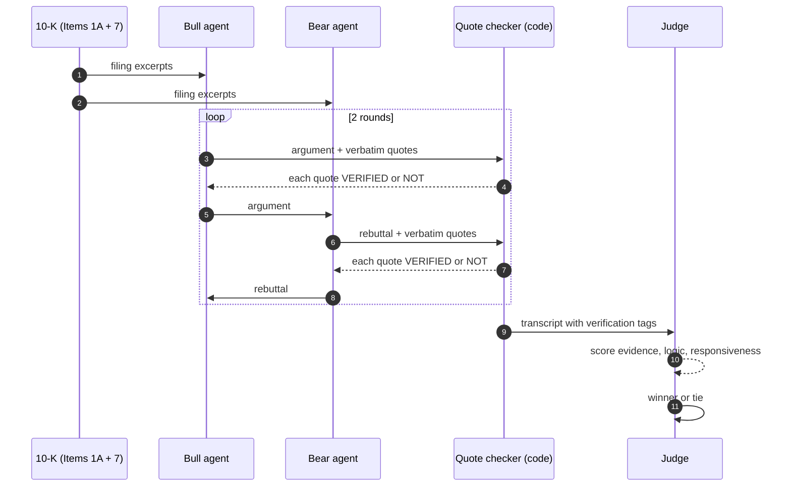

<div align="center">

# Bull vs. Bear

**Two AI agents argue a stock using its real SEC 10-K. Plain code checks every quote. Then the judge gets tested for bias.**

[](https://github.com/TJA0308/Bull-vs-Bear/actions/workflows/tests.yml)
[](https://tja0308.github.io/Bull-vs-Bear/)
[](LICENSE)


[**Open the live site**](https://tja0308.github.io/Bull-vs-Bear/) · [Findings](#findings) · [How it works](#how-it-works) · [Run it](#run-it) · [Code tour](#code-tour)


</div>

> **Not investment advice.** This is a research and argument tool built for learning.

## Why this exists

Ask an LLM to argue a stock and it will happily invent numbers and quotes. And when a second LLM judges the argument, you have no idea whether *its* verdict means anything. This project attacks both problems:

- **Grounding.** Debaters may only use the filing's Risk Factors and MD&A text, and every quote is checked by code. 190 of 192 quotes were real.
- **Judging.** The judge is treated as something to test. Is it swayed by listing order, speaking order, or which model it is? The last one turned out to matter a lot.

## Findings

Sixteen large companies, one 2-round debate per setup, judged repeatedly. Raw data is in `results/` and `debates/`. **Read every percentage below as one draw:** regenerating the same debates moved the bear's share by tens of points (finding 5). Comparisons that judge the *same* debates twice (finding 1) are not affected.

### 1. Which model judges changes who wins


The same 32 saved debates, judged by a second model (Sonnet 5.5). Before running it I fixed the decision rule: a drop of 20 points or more in the bear's share means the judge is the driver, under 10 means it is not. The drop was **35 points**, so the verdict is **judge-driven**.

| | Haiku 5.5 | Sonnet 5.5 |
|---|---|---|
| Bear's share of verdicts | **65%** | **29%** |
| Bull's share of verdicts | 5% | 51% |
| Ties | 30% | 20% |
| Mean margin, bull minus bear (30-point scale) | -1.88 | +0.55 |
| Setup where bull speaks first: bear's share | 71% | 27% |
| Setup where bear speaks first: bear's share | 58% | 31% |

Sonnet scored the bull higher in **28 of 32 debates** and lower in 3. Per criterion, the bear's lead over the bull shrinks or flips:

| Bull minus bear, mean score | Haiku 5.5 | Sonnet 5.5 |
|---|---|---|
| Evidence | -0.32 | -0.03 |
| Logic | -0.57 | +0.16 |
| Responsiveness | -0.98 | +0.43 |

**What this does not say.** Neither judge is "right": there is no ground truth for which side is correct, and Sonnet now leans slightly bull. Both judges are Claude models, so a bias shared by the whole model family is not tested. Thirty-two debates is a small sample, though a 35-point shift in 28 of 32 is not noise.

### 2. Part of the bear's edge is the debate format

When the bull speaks first, the bear always replies last. In that setup the "responsiveness" gap between the sides is large (-1.12). When the bear speaks first it nearly vanishes (-0.19). A smaller evidence and logic gap stays either way (about -0.3 to -0.4).

### 3. It is not an artifact of how the transcript was listed

Judging in the order the debate was actually spoken left the bear's edge essentially unchanged (it won 71% and 58% of judgments in the two setups, the bull 6% and 4%).

<details>
<summary><b>Judge bias test: the full table (listing order, Haiku 5.5)</b></summary>

<br>

Each debate was judged 3 times with bull listed first and 3 times with bear listed first (96 judgments per setup), in two setups: bull speaks first (original) or bear speaks first.

| | Bull speaks first | Bear speaks first |
|---|---|---|
| Bull wins | 4% | 8% |
| Tie | 25% | 36% |
| Bear wins | 71% | 55% |
| Bonus for the side listed first (points of 30, 95% range) | +0.2 (-0.2 to +0.6) | +0.4 (-0.2 to +1.0) |
| Judge disagrees with itself, same order | 28% of debates | 19% |
| Majority verdict changes when order is swapped | 31% | 44% |
| Swap-and-average: disagreement afterward | 6% | 19% |

- **No clear effect of listing order on scores.** Both ranges include zero (the interval uses a t critical value, wider than 1.96 with only 16 debates).
- **Order swaps flip verdicts more than rerunning only in the second setup** (44% against a 19% baseline), yet the score bonus stays small.
- **Swap-and-average helped in one setup and not the other** (28% to 6%, then 19% to 19%), so it is not a reliable fix on this much data.
- **A confound in the listing test.** When the judge lists the side that spoke second first, it reads a reply before the argument it answers. That is why finding 3 above reran everything in speaking order.

</details>

### 4. Quote verification works, and the number rule matters


- **190 of 192 quotes (99.0%)** were found in the filing. The two misses scored 72 and 82 against a pass mark of 90. Fabricated quotes scored 54 to 63, and quotes from the wrong company never passed.
- **The fuzzy score cannot see a changed figure.** With one digit changed in the 98 quotes that contain a number, every one still scored 90 or more. So the checker also requires every number in the quote to appear in the part of the filing it matched. That rejects all 98, and none of the 192 real verdicts changed.
- **Limit:** it still accepts a one-word wording change (91% of quotes with a word swapped). A verified quote proves the words are in the filing, not that they support the claim.

### 5. One debate per company is too noisy to pin down the bear's share

A control run (Phase C): the 16 debates were regenerated from identical input and judged the same way. The bear's share of verdicts fell from **71% to 42%**, mostly because bear wins became ties (bull 6% to 0%, tie 23% to 58%). Per-company results did not repeat (AAPL went from 67% to 0%). The average score margin moved far less (-1.96 to -1.40 on a 30-point scale), and the bull won 0 to 10% of judgments in every run, so the *direction* of the bear's edge looks stable while its *size* does not.

This is why the pre-set rule returned "too noisy to read" for the second Phase C question: giving the debaters equal-size chunks of Risk Factors and MD&A produced a 58% bear share, which is inside that noise. Phase B's judge comparison is unaffected, because both judges scored the very same debates.

### 6. With five draws, the bear's edge is real for this judge, and the input is not the cause

Phase D repeated the debates: 5 independent draws of the 16 companies on the full input and 5 on the balanced input, judged by Haiku 5.5. The rule was committed before the run and uses the mean score margin per draw, because that was the steadier measure. It cost $1.53.

| | Full input (5 draws) | Balanced input (5 draws) |
| --- | --- | --- |
| Mean margin, 30-point scale (negative = bear ahead) | **-1.89** | **-1.91** |
| Spread between draws (sd) | 0.32 | 0.39 |
| Bear share per draw | 71, 42, 62, 62, 69% | 58, 73, 56, 54, 62% |

- **The bear's lead is real under this judge:** -1.89 with a 95% interval of ±0.40, entirely below zero, though small: under 2 points out of 30. The bull won 0 to 10% of judgments in every draw.
- **Input balance is not what drives it:** balanced minus full is -0.02 ±0.54, far inside the 1-point size set as mattering. Equal-size chunks of Risk Factors and MD&A did not help the bull.
- **Shares from one draw are good to roughly ±15 points** (the bear share ranged 42% to 73% on near-identical setups), which is why the earlier single-draw percentages carry a caveat.
- **Limits:** this is Haiku judging, bull speaking first. Under Sonnet the original debates came out slightly *bull*-ahead (Phase B), so the bear's edge belongs to this judge, not to the debates alone. The bear-first setup was not repeated.

## How it works



**Design choices worth knowing**

- **Code verifies, the LLM never does.** A judge that "checks" a quote can hallucinate the check. Python cannot.
- **Debates are saved as JSON.** The site reads files, so visitors never spend API credits and the demo cannot be run up.
- **Bad model output gets one retry** with the error fed back, then fails loudly. Every claim must have a string `claim` and `quote`, validated *before* the citation checker runs.
- **Pre-registered thresholds.** The judge-comparison rule (20 points big, 10 small) lives in `bias.py` as constants, written before the paid run.
- **Unknown models are refused before any API call**, so a typo cannot spend money.

## Run it

Requires Python 3.10+ (CI runs 3.13).

<details open>
<summary><b>Setup</b></summary>

```bash
python -m venv .venv
.venv\Scripts\Activate.ps1        # Windows PowerShell
# source .venv/bin/activate       # macOS / Linux
pip install -r requirements.txt
```

Create a `.env` file in the project root (git-ignored, never commit it):

```
ANTHROPIC_API_KEY=your-key
SEC_USER_AGENT=Your Name your-email@example.com
```

The SEC requires the `User-Agent` to identify you and asks for no more than about 10 requests per second.

</details>

| Goal | Command | Cost |
|---|---|---|
| Download a 10-K and extract the two sections | `python fetch.py NVDA` | free |
| Run one debate and save it | `python debate.py AAPL` | about 1.5 cents (5 calls) |
| Run the tests (none call the API) | `python -m pytest` | free |
| Re-print the listing-order bias report | `python bias.py --report` | free |
| Judge saved debates in speaking order (Haiku) | `python bias.py --chrono` | about 4 cents (96 calls) |
| Judge them with another model | `python bias.py --chrono --judge-model claude-sonnet-5-5` | about 80 cents |
| Compare two judges' saved results | `python bias.py --compare claude-sonnet-5-5` | free |
| Rebuild the site data | `python build_site.py` | free |
| Preview the site | `python -m http.server 8123 --directory site` | free |

<details>
<summary><b>Sample output of <code>python debate.py AAPL</code></b></summary>

```text
AAPL: filing text is 15,071 words
round 1: bull speaks
round 1: bear speaks
round 2: bull speaks
round 2: bear speaks
judge deliberates

saved debates\AAPL.json
winner: tie  scores: {'bull': {'evidence': 8, 'logic': 7, 'responsiveness': 7}, 'bear': {'evidence': 7, 'logic': 7, 'responsiveness': 8}}
citations verified: 12/12 (bull 6/6, bear 6/6)
cost: $0.0154 over 5 calls
```

</details>

`build_site.py` reads the cached filings in `data/raw/`, so run `python fetch.py TICKER` first for any company that is not cached. `.github/workflows/pages.yml` publishes `site/` to GitHub Pages on every push to `main` that touches `site/`; it needs no secrets.

Tested on AAPL, ADBE, AMD, AMZN, COST, CRM, GOOGL, KO, META, MSFT, NFLX, NKE, NVDA, PEP, TSLA and WMT.

## Code tour

New here? Read in this order:

1. [`citations.py`](citations.py): the quote checker. Small, and the core idea.
2. [`fetch.py`](fetch.py): EDGAR lookup, filing cache, section extraction.
3. [`debate.py`](debate.py): the agents, the judge prompt, the debate loop.
4. [`bias.py`](bias.py): the experiments and their statistics.
5. [`tests/`](tests): what each module promises, in executable form.

```text
.
├── fetch.py            EDGAR lookup, download, cache, extract Item 1A and Item 7
├── llm.py              the one place that calls Claude: model, cost tracking, JSON parsing
├── debate.py           bull and bear agents, judge, debate JSON
├── citations.py        does this quote really appear in the filing?
├── bias.py             order-swap, speaking-order and judge-model experiments
├── build_site.py       saved debates + results  ->  site/data.js
├── site/               static page: debate explorer, bias lab, quote-checker experiment
├── debates/            one JSON per ticker, plus variants/bear-first/
├── results/            saved bias and judge-comparison results
├── docs/               the animated SVGs used in this README
├── tests/              37 pytest tests, none call the API
├── scripts/            check_key.py: one tiny real call to verify the API key
├── data/               cached filings and extracted text (git-ignored)
└── .github/workflows/  tests.yml (pytest on every PR and push), pages.yml (deploy site)
```

## Known limitations

- **Banks and some other filers** (for example JPM) incorporate MD&A by reference from a separate exhibit, so there is no MD&A in the 10-K body. `fetch.py` raises a clear error when a section is under 500 words instead of returning junk.
- **ETFs and foreign filers** have no 10-K, so the lookup raises an error.
- Section extraction uses regular expressions on the filing text, so unusual layouts may need pattern tweaks.
- **Small samples.** Sixteen companies; treat every percentage as a rough estimate.
- **Same-family judging.** Debaters and both judges are Claude models.

## Roadmap

- [x] Ticker to CIK lookup, 10-K download, section extraction
- [x] Bull and bear agents, judge with a scoring rubric, cost logging
- [x] Citation checker with exact, fuzzy and number rules
- [x] Judge bias tests: listing order, speaking order, judge model
- [x] Interactive static site, deployed to GitHub Pages
- [x] Tests in CI, MIT license, `main` protected against force-push and deletion
- [ ] Put the judge-model finding on the site
- [x] Input experiment (Phase C): rerun noise control plus balanced input; too noisy to read
- [x] Repeat each debate 5 times (Phase D): the bear's edge is real for the Haiku judge, and input balance is not the cause
- [ ] Repeat the bear-first setup and the Sonnet judging the same way
- [ ] A third judge, to separate model size from model family
- [ ] Refresh debates when a new 10-K appears

## License

[MIT](LICENSE).
